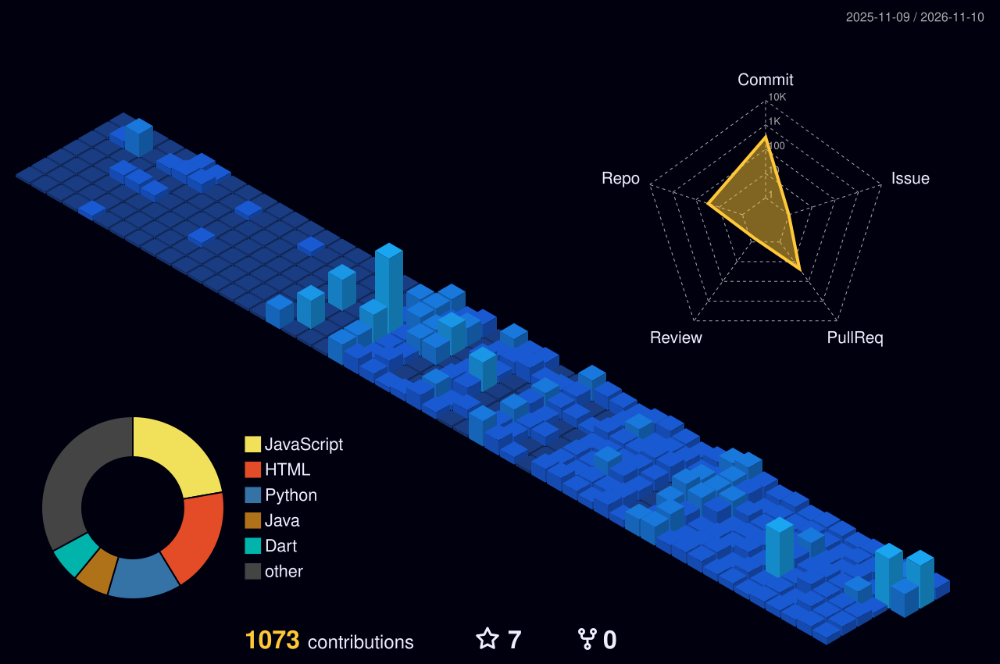

  

 

  &nbsp;
  &nbsp;
  &nbsp;
  &nbsp;
  

 

  

 

### Featured Engineering Systems

  
  

  
  

  
  

 

  

 

### Additional Repositories & Research

| Repository | Domain | Engineering Scope |
| :--- | :--- | :--- |
| [PeerLearn](https://github.com/rakaalpiansyah/PeerLearn) | Collaborative Web | Peer-to-peer study and knowledge-sharing platform built with modern JavaScript. |
| [Ai---agronex](https://github.com/rakaalpiansyah/Ai---agronex) | Agricultural AI | Python machine learning pipeline for crop analytics and decision support. |
| [ASL Sign Language Translator](https://github.com/rakaalpiansyah/ASL---SIGN-LANGUAGE-TRANSLATOR-) | Computer Vision | Real-time hand gesture recognition for American Sign Language translation. |
| [AR-CHESS-ARENA](https://github.com/rakaalpiansyah/AR-CHESS-ARENA) & [ar-chess-unity](https://github.com/rakaalpiansyah/ar-chess-unity) | Augmented Reality & Mobile | Spatial chess arena built across Flutter/Dart and Unity 3D engines. |
| [lossless-compression-benchmark](https://github.com/rakaalpiansyah/lossless-compression-benchmark) | Systems & Algorithms | Empirical throughput and ratio benchmarking of lossless compression algorithms in Python. |
| [polyglot-workspace](https://github.com/rakaalpiansyah/polyglot-workspace) | Multi-Language Systems | Cross-language software engineering experiments and architecture patterns. |

 

### 3D Contribution Terrain & Activity

  

  
  

